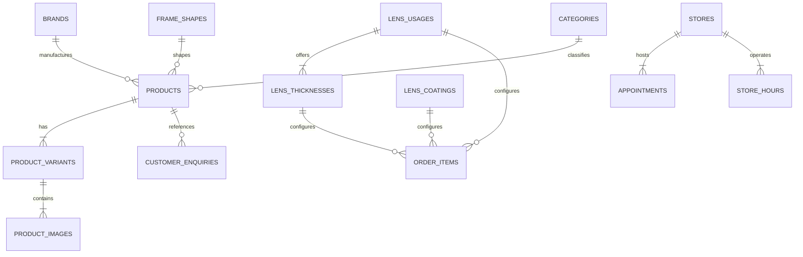

# Optii Optical Platform — Greenfield Architecture Specification

> **Platform:** Optii (Standalone Premium Optical E-Commerce & Retail Management Platform)  
> **Status:** Revised Clean-Slate Architecture (Zero Legacy Dependencies)  
> **Design Standard:** Ace & Tate Reference (`https://www.aceandtate.com/us/sunglasses/men-sunglasses`)  
> **Engineering Directives:** Strict Component Isolation, Relational Database Constraints, Server-Side Validation, Role-Based Access Control, Responsive 360px–1440px Ergonomics.

---

## 1. Architectural Philosophy & Project Boundaries

Optii is engineered from the ground up as a **completely new product**, not a continuation, port, or migration of any legacy system:
1. **Dedicated Database (`data/optii.db`):** Completely clean database designed specifically for Optii’s schema. No legacy records or deprecated table structures.
2. **Decoupled Three-Tier Topology:**
   - **Customer Storefront (`src/` / `public/`):** Fast, minimalist, high-conversion boutique with Ace & Tate aesthetics.
   - **Administrative Portal (`admin/`):** Isolated, authenticated management suite for catalog, inventory, appointments, and content.
   - **Backend API Service (`server/` / `backend/`):** RESTful JSON API with strict schema validation, role-based authorization, and atomic transaction locks.
3. **True Optical Specifications:** Frames are characterized by precise millimeter measurements (Lens width, Bridge width, Temple length), multi-image 1:1 galleries, and a progressive 4-step optical lens configurator.
4. **Omnichannel Commerce:** Direct WhatsApp order generation with pre-filled markdown specifications alongside in-store appointment booking with slot-level collision prevention.

---

## 2. High-Level System Architecture

```mermaid
flowchart TB
    subgraph ClientTier["Presentation Tier"]
        Storefront["Optii Customer Storefront<br/>• Minimalist Editorial Aesthetic (Ace & Tate)<br/>• 4-Col Desktop / 2-Col Mobile Grid<br/>• Progressive 4-Step Lens Configurator<br/>• Viewport Safety: 360px to 1440px"]
        AdminPortal["Optii Admin Management Suite<br/>• Dedicated Staff & Optometrist Portal<br/>• Variant Matrix & Multi-Image Manager<br/>• Appointment Calendar & Patient Queue<br/>• Dynamic Lens & Pricing Manager"]
    end

    subgraph ServiceTier["Backend API Service Tier (Express + TypeScript/Node)"]
        APIGateway["REST API Router (/api)<br/>• Public Endpoints (/products, /lenses, /stores, /appointments)<br/>• Protected Admin Endpoints (/admin/*)"]
        AuthModule["Auth & RBAC Service<br/>• JWT Stateless Authentication<br/>• Roles: Admin, Optometrist, Staff"]
        ValidationModule["Validation Engine (Zod / Joi)<br/>• Prescription Range Validation<br/>• Appointment Concurrency Sanitization"]
        WhatsAppModule["WhatsApp Commerce Engine<br/>• Markdown String Builder<br/>• URI Encoding & Lead Logging"]
        ImagePipeline["Asset Processing Pipeline<br/>• Multer + Jimp / Sharp<br/>• WebP Optimization & Thumbnail Generation"]
    end

    subgraph PersistenceTier["Data & Persistence Tier"]
        DB[("Optii Relational Database (data/optii.db)<br/>• Strict Foreign Keys (PRAGMA foreign_keys = ON)<br/>• Unique Composite Constraints<br/>• Portable DDL to PostgreSQL")]
        FileStorage[("Media Storage<br/>• Local public/uploads/ (Immutable cache)<br/>• Cloud Object Storage Ready")]
    end

    Storefront -->|HTTPS JSON| APIGateway
    AdminPortal -->|HTTPS JSON (Bearer JWT)| APIGateway
    APIGateway --> AuthModule
    APIGateway --> ValidationModule
    APIGateway --> WhatsAppModule
    APIGateway --> ImagePipeline
    ValidationModule --> DB
    ImagePipeline --> FileStorage
```

---

## 3. Customer Storefront Component Structure

The customer storefront is organized into modular, single-responsibility components:

```
src/ (or public/modular/)
├── components/
│   ├── layout/
│   │   ├── AnnouncementBar.js        # 36px high-contrast promotional banner
│   │   ├── Header.js                 # 60px fixed minimalist header
│   │   ├── NavigationDrawer.js       # Slide-over category menu with accordions
│   │   ├── CartDrawer.js             # Slide-out bag with itemized lens upgrades & INR totals
│   │   ├── WishlistDrawer.js         # Saved frames drawer
│   │   └── Footer.js                 # Minimalist editorial footer & store hours
│   ├── plp/
│   │   ├── CollectionHeader.js       # Category title, count, and editorial subtitle
│   │   ├── StickyFilterBar.js        # Sticky pill trigger: "All filters (n)" + Sort dropdown
│   │   ├── FilterDrawer.js           # Left slide-over drawer (~530px) with shapes & fit
│   │   ├── ProductGrid.js            # 4-col desktop / 2-col mobile responsive grid
│   │   └── ProductCard.js            # 1:1 square canvas, studio-to-model hover, swatches
│   ├── pdp/
│   │   ├── ProductGallery.js         # Multi-image scrollable gallery + fullscreen modal
│   │   ├── ProductMeta.js            # Title, SKU, price in INR, colorway swatches
│   │   ├── FrameMeasurements.js      # Millimeter specifications schematic (51-20-150 mm)
│   │   └── StickyActionBottomBar.js  # Mobile sticky bottom purchase bar
│   ├── lenses/
│   │   ├── LensConfiguratorModal.js  # Progressive 4-step modal container
│   │   ├── Step1Usage.js             # Distance, Reading, Progressive, Fashion
│   │   ├── Step2Prescription.js      # File upload OR manual SPH, CYL, AXIS, ADD, PD
│   │   ├── Step3Thickness.js         # 1.50, 1.60, 1.67, 1.74 with thickness comparison
│   │   ├── Step4Coatings.js          # Anti-reflective, Blue light, Transitions, Polarized
│   │   └── LensPriceTally.js         # Real-time running total in INR
│   ├── booking/
│   │   ├── EyeTestModal.js           # Store appointment wizard
│   │   ├── StoreBranchSelector.js    # Optical branch picker
│   │   ├── SlotPicker.js             # Dynamic 30-min slot pills with collision locks
│   │   └── CustomerForm.js           # Name, phone, email, optometrist notes
│   └── common/
│       ├── ButtonPill.js             # 9999px full pill button
│       ├── ColorSwatch.js            # 28px touch container, 20px dot, 2px active ring
│       ├── ShapeIcon.js              # Miniature line-art frame shape SVG
│       └── CurrencyDisplay.js        # Standardized INR formatter (`₹9,500`)
```

---

## 4. Admin Management Application Structure

The administrative interface operates as an isolated, secure control center:

```
admin/
├── layout/
│   ├── AdminLayout.js                # Secure shell with sidebar and top bar
│   ├── AdminSidebar.js               # Navigation: Catalog, Orders, Appointments, Content
│   └── AdminAuthGuard.js             # JWT verification and route protection
├── modules/
│   ├── catalog/
│   │   ├── ProductTable.js           # Paginated data table with search and filters
│   │   ├── ProductEditor.js          # Master frame record (name, slug, millimeter dimensions)
│   │   ├── VariantMatrix.js          # Colorways, SKUs, prices, stock quantities
│   │   └── MediaUploader.js          # Drag-and-drop studio front and model photos
│   ├── taxonomy/
│   │   ├── BrandManager.js           # Brands, descriptions, logos
│   │   ├── ShapeManager.js           # Frame shapes (Round, Square, Aviator) + SVG icons
│   │   └── CategoryManager.js        # Eyeglasses, Sunglasses, Accessories hierarchies
│   ├── lenses/
│   │   ├── LensUsageEditor.js        # Lens usage types and baseline fees
│   │   ├── ThicknessPricingGrid.js   # Index options (1.50–1.74) and price tiers
│   │   └── CoatingEditor.js          # Coating add-ons and feature descriptions
│   ├── appointments/
│   │   ├── AppointmentCalendar.js    # Daily & weekly clinic schedule view
│   │   ├── SlotConfigurator.js       # Store hours, 30-min intervals, optometrist limits
│   │   └── BookingStatusModal.js     # Confirm, reschedule, or cancel bookings
│   ├── orders/
│   │   ├── OrderListTable.js         # Orders queue with status tags
│   │   └── OrderDetailView.js        # Customer contact, itemized lenses, prescription file
│   └── settings/
│       ├── StoreLocationEditor.js    # Physical store branches, addresses, contacts
│       └── WhatsAppConfig.js         # Business number and pre-filled message templates
```

---

## 5. Optii Relational Database Schema (`data/optii.db`)

The persistence layer uses a normalized relational schema with strict foreign key constraints, cascading rules, and partial unique indexes to guarantee integrity.



### 5.1 Relational DDL Specification

```sql
-- 1. Administrative & Staff Users
CREATE TABLE users (
    id INTEGER PRIMARY KEY AUTOINCREMENT,
    username TEXT UNIQUE NOT NULL,
    password_hash TEXT NOT NULL,
    full_name TEXT NOT NULL,
    role TEXT NOT NULL DEFAULT 'staff' CHECK (role IN ('admin', 'optometrist', 'staff')),
    created_at DATETIME DEFAULT CURRENT_TIMESTAMP
);

-- 2. Optical Brands
CREATE TABLE brands (
    id INTEGER PRIMARY KEY AUTOINCREMENT,
    name TEXT UNIQUE NOT NULL,
    slug TEXT UNIQUE NOT NULL,
    logo_url TEXT,
    description TEXT,
    is_active BOOLEAN DEFAULT 1,
    created_at DATETIME DEFAULT CURRENT_TIMESTAMP
);

-- 3. Frame Shapes (Powers Ace & Tate Filter Drawer)
CREATE TABLE frame_shapes (
    id INTEGER PRIMARY KEY AUTOINCREMENT,
    name TEXT UNIQUE NOT NULL,
    slug TEXT UNIQUE NOT NULL,
    icon_svg TEXT NOT NULL,
    display_order INTEGER DEFAULT 0,
    is_active BOOLEAN DEFAULT 1
);

-- 4. Product Categories
CREATE TABLE categories (
    id INTEGER PRIMARY KEY AUTOINCREMENT,
    name TEXT NOT NULL,
    slug TEXT UNIQUE NOT NULL,
    category_type TEXT NOT NULL CHECK (category_type IN ('glasses', 'sunglasses', 'accessories', 'contact_lenses', 'eyecare')),
    gender TEXT DEFAULT 'unisex' CHECK (gender IN ('men', 'women', 'unisex')),
    display_order INTEGER DEFAULT 0,
    is_active BOOLEAN DEFAULT 1
);

-- 5. Products Master Table
CREATE TABLE products (
    id INTEGER PRIMARY KEY AUTOINCREMENT,
    brand_id INTEGER NOT NULL REFERENCES brands(id) ON DELETE RESTRICT,
    shape_id INTEGER NOT NULL REFERENCES frame_shapes(id) ON DELETE RESTRICT,
    category_id INTEGER NOT NULL REFERENCES categories(id) ON DELETE RESTRICT,
    name TEXT NOT NULL,
    slug TEXT UNIQUE NOT NULL,
    sku TEXT UNIQUE NOT NULL,
    description TEXT,
    base_price_inr INTEGER NOT NULL CHECK (base_price_inr >= 0),
    gender TEXT NOT NULL DEFAULT 'unisex' CHECK (gender IN ('men', 'women', 'unisex')),
    material TEXT NOT NULL, -- 'Italian Bio-Acetate', 'Japanese Titanium', 'Combi'
    frame_fit TEXT NOT NULL CHECK (frame_fit IN ('Narrow', 'Medium', 'Wide')),
    lens_width_mm INTEGER NOT NULL CHECK (lens_width_mm > 0),
    bridge_width_mm INTEGER NOT NULL CHECK (bridge_width_mm > 0),
    temple_length_mm INTEGER NOT NULL CHECK (temple_length_mm > 0),
    frame_height_mm INTEGER,
    total_width_mm INTEGER,
    is_featured BOOLEAN DEFAULT 0,
    is_active BOOLEAN DEFAULT 1,
    created_at DATETIME DEFAULT CURRENT_TIMESTAMP,
    updated_at DATETIME DEFAULT CURRENT_TIMESTAMP
);

-- 6. Product Variants (Colorways)
CREATE TABLE product_variants (
    id INTEGER PRIMARY KEY AUTOINCREMENT,
    product_id INTEGER NOT NULL REFERENCES products(id) ON DELETE CASCADE,
    color_name TEXT NOT NULL,
    color_hex TEXT NOT NULL, -- e.g. '#5a3825'
    color_secondary_hex TEXT, -- For tortoise or dual-tone frames
    sku TEXT UNIQUE NOT NULL,
    price_override_inr INTEGER,
    stock_quantity INTEGER NOT NULL DEFAULT 10 CHECK (stock_quantity >= 0),
    is_default BOOLEAN DEFAULT 0,
    is_active BOOLEAN DEFAULT 1
);

-- 7. Product Images (Studio & Editorial Model Pairs)
CREATE TABLE product_images (
    id INTEGER PRIMARY KEY AUTOINCREMENT,
    variant_id INTEGER NOT NULL REFERENCES product_variants(id) ON DELETE CASCADE,
    image_type TEXT NOT NULL CHECK (image_type IN ('studio_front', 'model_on_face', 'angle_45', 'hinge_detail', 'packaging')),
    image_url TEXT NOT NULL,
    alt_text TEXT,
    display_order INTEGER DEFAULT 0
);

-- 8. Lens Options: Usage Types (Step 1)
CREATE TABLE lens_usages (
    id INTEGER PRIMARY KEY AUTOINCREMENT,
    name TEXT NOT NULL,
    slug TEXT UNIQUE NOT NULL,
    description TEXT,
    base_price_inr INTEGER NOT NULL DEFAULT 0,
    display_order INTEGER DEFAULT 0,
    is_active BOOLEAN DEFAULT 1
);

-- 9. Lens Options: Thickness / Index (Step 3)
CREATE TABLE lens_thicknesses (
    id INTEGER PRIMARY KEY AUTOINCREMENT,
    usage_id INTEGER NOT NULL REFERENCES lens_usages(id) ON DELETE CASCADE,
    name TEXT NOT NULL,
    index_rating NUMERIC NOT NULL, -- 1.50, 1.60, 1.67, 1.74
    description TEXT,
    price_inr INTEGER NOT NULL DEFAULT 0,
    recommended_sph_range TEXT,
    display_order INTEGER DEFAULT 0,
    is_active BOOLEAN DEFAULT 1
);

-- 10. Lens Options: Coatings (Step 4)
CREATE TABLE lens_coatings (
    id INTEGER PRIMARY KEY AUTOINCREMENT,
    name TEXT NOT NULL,
    slug TEXT UNIQUE NOT NULL,
    description TEXT,
    price_inr INTEGER NOT NULL DEFAULT 0,
    display_order INTEGER DEFAULT 0,
    is_active BOOLEAN DEFAULT 1
);

-- 11. Stores / Optical Branches
CREATE TABLE stores (
    id INTEGER PRIMARY KEY AUTOINCREMENT,
    name TEXT NOT NULL,
    address TEXT NOT NULL,
    city TEXT NOT NULL,
    phone TEXT NOT NULL,
    email TEXT,
    slot_interval_minutes INTEGER DEFAULT 30,
    is_active BOOLEAN DEFAULT 1
);

-- 12. Store Operating Hours
CREATE TABLE store_hours (
    id INTEGER PRIMARY KEY AUTOINCREMENT,
    store_id INTEGER NOT NULL REFERENCES stores(id) ON DELETE CASCADE,
    day_of_week INTEGER NOT NULL CHECK (day_of_week BETWEEN 0 AND 6),
    open_time TEXT NOT NULL,
    close_time TEXT NOT NULL,
    is_closed BOOLEAN DEFAULT 0
);

-- 13. Eye Test Appointments (With Atomic Overlap Prevention)
CREATE TABLE appointments (
    id INTEGER PRIMARY KEY AUTOINCREMENT,
    appointment_number TEXT UNIQUE NOT NULL,
    store_id INTEGER NOT NULL REFERENCES stores(id) ON DELETE RESTRICT,
    customer_name TEXT NOT NULL,
    customer_phone TEXT NOT NULL,
    customer_email TEXT,
    appointment_date TEXT NOT NULL,
    start_time TEXT NOT NULL,
    end_time TEXT NOT NULL,
    status TEXT NOT NULL DEFAULT 'confirmed' CHECK (status IN ('pending', 'confirmed', 'cancelled', 'completed')),
    notes TEXT,
    created_at DATETIME DEFAULT CURRENT_TIMESTAMP
);

CREATE UNIQUE INDEX idx_unique_appointment_slot 
ON appointments(store_id, appointment_date, start_time) 
WHERE status != 'cancelled';

-- 14. Customer Enquiries & WhatsApp Commerce Leads
CREATE TABLE customer_enquiries (
    id INTEGER PRIMARY KEY AUTOINCREMENT,
    channel TEXT NOT NULL DEFAULT 'whatsapp' CHECK (channel IN ('whatsapp', 'web_form', 'call')),
    customer_name TEXT,
    customer_phone TEXT,
    product_id INTEGER REFERENCES products(id) ON DELETE SET NULL,
    variant_id INTEGER REFERENCES product_variants(id) ON DELETE SET NULL,
    enquiry_payload TEXT NOT NULL, -- JSON snapshot of frame specs + lens selections
    status TEXT DEFAULT 'new' CHECK (status IN ('new', 'in_progress', 'converted', 'closed')),
    created_at DATETIME DEFAULT CURRENT_TIMESTAMP
);

-- 15. Orders Master Table
CREATE TABLE orders (
    id INTEGER PRIMARY KEY AUTOINCREMENT,
    order_number TEXT UNIQUE NOT NULL,
    customer_name TEXT NOT NULL,
    customer_phone TEXT NOT NULL,
    customer_email TEXT,
    shipping_address TEXT NOT NULL,
    city TEXT,
    state TEXT,
    pincode TEXT,
    subtotal_inr INTEGER NOT NULL,
    discount_inr INTEGER DEFAULT 0,
    total_amount_inr INTEGER NOT NULL,
    payment_method TEXT NOT NULL CHECK (payment_method IN ('online', 'cod', 'in_store')),
    payment_status TEXT NOT NULL DEFAULT 'pending' CHECK (payment_status IN ('pending', 'paid', 'failed')),
    order_status TEXT NOT NULL DEFAULT 'placed' CHECK (order_status IN ('placed', 'processing', 'lab_glazing', 'shipped', 'delivered', 'cancelled')),
    items_json TEXT NOT NULL,
    prescription_file_url TEXT,
    prescription_data TEXT,
    tracking_number TEXT,
    created_at DATETIME DEFAULT CURRENT_TIMESTAMP,
    updated_at DATETIME DEFAULT CURRENT_TIMESTAMP
);

-- 16. Eye Care Editorial Articles
CREATE TABLE eyecare_articles (
    id INTEGER PRIMARY KEY AUTOINCREMENT,
    title TEXT NOT NULL,
    slug TEXT UNIQUE NOT NULL,
    excerpt TEXT,
    content_markdown TEXT NOT NULL,
    cover_image_url TEXT,
    author TEXT DEFAULT 'Senior Optometrist',
    is_published BOOLEAN DEFAULT 1,
    published_at DATETIME DEFAULT CURRENT_TIMESTAMP
);

-- 17. Store Settings & Key-Value Configuration
CREATE TABLE site_settings (
    key TEXT PRIMARY KEY,
    value TEXT NOT NULL,
    description TEXT,
    updated_at DATETIME DEFAULT CURRENT_TIMESTAMP
);
```

---

## 6. Summary of Architectural Responsibilities

1. **Clean Separation:** Customer storefront (`src/`) has zero admin bundle contamination. Admin portal (`admin/`) is protected behind JWT RBAC guards.
2. **True Optical Schemas:** Products support millimeter dimensions and 1:1 image pairs (`studio_front` + `model_on_face`).
3. **Robust Concurrency:** Appointment double-booking is eliminated at the database level with `idx_unique_appointment_slot`.
4. **Fast, Lightweight Execution:** Dual support for local SQLite development and PostgreSQL cloud deployment without code refactoring.
