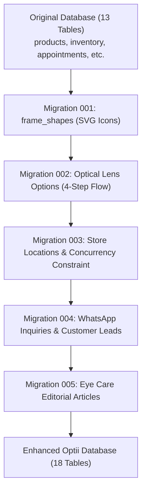

# Database Migration Plan: Vision Opticals → Optii

> **Document Status:** Comprehensive Data Compatibility, Backup, Migration & Rollback Strategy  
> **Original Database:** `C:\Users\shafe\Desktop\Projects\vision_opticals\data\vision_opticals.db`  
> **Target Database:** `C:\Users\shafe\Desktop\Projects\optii\data\vision_opticals.db`  
> **Primary Directive:** Zero Data Loss, Strict Backward Compatibility, Non-Destructive Migrations, and Instant Rollback Capability.

---

## 1. Current Database Audit & Data Compatibility

### 1.1 Existing Tables & Record Counts
An automated schema and row-count inspection of both `vision_opticals/data/vision_opticals.db` and `optii/data/vision_opticals.db` confirms complete schema parity:

| Table Name | Record Count | Business Data Contained | Compatibility Status |
| :--- | :---: | :--- | :---: |
| `users` | 1 | Admin credentials with bcrypt password hash | Compatible |
| `categories` | 5 | Eyeglasses, Sunglasses, Reading, Computer Glasses, Contact Lenses | Compatible |
| `brands` | 19 | Ray-Ban, Gucci, Oakley, Essilor, Zeiss, Silhouette, etc. | Compatible |
| `products` | 19 | Optical frame specifications, millimeter measurements, prices in INR | Compatible |
| `product_images`| 37 | Studio front, 45° angle, and profile product photography | Compatible |
| `inventory` | 19 | Stock counts, SKUs, and low-stock alert thresholds | Compatible |
| `inventory_logs`| 40 | Historical audit log of every stock change, staff username, and reason | Compatible |
| `offers` | 2 | Promotional discount codes and banner configurations | Compatible |
| `homepage_sections`| 7 | Layout configuration for hero, stats, and discovery blocks | Compatible |
| `store_settings`| 14 | Store phone, address, WhatsApp number, opening hours, SEO meta | Compatible |
| `appointments` | 12 | Customer bookings with date, slot, contact info, and status | Compatible |
| `orders` | 8 | Customer orders with itemized JSON, prescriptions, tracking numbers | Compatible |
| `modular_components`| 13 | Modular homepage widgets with configuration JSON and soft-delete | Compatible |

**Compatibility Conclusion:**  
The existing database is **100% compatible** between the original and new projects. Optii can query and update existing products, inventory, appointments, and orders without breaking any existing workflow.

---

## 2. Backup & Disaster Recovery Protocol

Before executing any database alteration or schema migration, an automated snapshot is created.

### 2.1 Backup Locations & Naming Convention
- Directory: `optii/data/backups/`
- Naming format: `vision_opticals_backup_YYYYMMDD_HHMMSS.db`
- **Initial Baseline Backup Created:**
  `optii/data/backups/vision_opticals_backup_initial.db` (Verified intact: 163,840 bytes).

### 2.2 Backup & Rollback Verification Command
```powershell
# Take a new timestamped backup before running a migration
$timestamp = Get-Date -Format "yyyyMMdd_HHmmss"
Copy-Item "C:\Users\shafe\Desktop\Projects\optii\data\vision_opticals.db" `
          "C:\Users\shafe\Desktop\Projects\optii\data\backups\vision_opticals_backup_$timestamp.db" -Force

# In the event of an unexpected migration issue, restore instantly:
Copy-Item "C:\Users\shafe\Desktop\Projects\optii\data\backups\vision_opticals_backup_initial.db" `
          "C:\Users\shafe\Desktop\Projects\optii\data\vision_opticals.db" -Force
```

---

## 3. Evolutionary Schema Migration Roadmap (Non-Destructive)

To satisfy the requirements of `AGENTS.md` (Ace & Tate design system, millimeter frame dimensions, progressive 4-step lens configurator, and atomic slot booking), we introduce **additive, non-destructive migrations**.

No existing tables or columns will be dropped.



---

### Migration 001: Frame Shapes with SVG Line-Art Icons
- **Purpose:** Powers the Ace & Tate filter drawer allowing users to filter by shape (Round, Square, Aviator, Cat-Eye, Hexagonal, Oval) with miniature optical frame SVGs.

#### Up Migration (SQL):
```sql
CREATE TABLE IF NOT EXISTS frame_shapes (
  id INTEGER PRIMARY KEY AUTOINCREMENT,
  name TEXT UNIQUE NOT NULL,
  slug TEXT UNIQUE NOT NULL,
  icon_svg TEXT NOT NULL,
  display_order INTEGER DEFAULT 0,
  is_active BOOLEAN DEFAULT 1
);

-- Seed standardized optical frame shapes
INSERT OR IGNORE INTO frame_shapes (name, slug, icon_svg, display_order) VALUES
('Round', 'round', '<svg viewBox="0 0 48 24" fill="none" stroke="currentColor"><circle cx="14" cy="12" r="8"/><circle cx="34" cy="12" r="8"/><line x1="22" y1="12" x2="26" y2="12"/></svg>', 1),
('Square', 'square', '<svg viewBox="0 0 48 24" fill="none" stroke="currentColor"><rect x="6" y="5" width="16" height="14" rx="2"/><rect x="26" y="5" width="16" height="14" rx="2"/><line x1="22" y1="12" x2="26" y2="12"/></svg>', 2),
('Aviator', 'aviator', '<svg viewBox="0 0 48 24" fill="none" stroke="currentColor"><path d="M7 6 C12 6, 21 8, 20 16 C19 19, 13 20, 8 18 Z"/><path d="M41 6 C36 6, 27 8, 28 16 C29 19, 35 20, 40 18 Z"/><line x1="20" y1="9" x2="28" y2="9"/><line x1="20" y1="13" x2="28" y2="13"/></svg>', 3),
('Cat-Eye', 'cat-eye', '<svg viewBox="0 0 48 24" fill="none" stroke="currentColor"><path d="M6 7 C14 5, 21 9, 20 16 C19 19, 11 19, 8 17 Z"/><path d="M42 7 C34 5, 27 9, 28 16 C29 19, 37 19, 40 17 Z"/><line x1="20" y1="12" x2="28" y2="12"/></svg>', 4),
('Rectangle', 'rectangle', '<svg viewBox="0 0 48 24" fill="none" stroke="currentColor"><rect x="6" y="7" width="16" height="10" rx="1"/><rect x="26" y="7" width="16" height="10" rx="1"/><line x1="22" y1="12" x2="26" y2="12"/></svg>', 5),
('Hexagonal', 'hexagonal', '<svg viewBox="0 0 48 24" fill="none" stroke="currentColor"><polygon points="14,4 21,8 21,16 14,20 7,16 7,8"/><polygon points="34,4 41,8 41,16 34,20 27,16 27,8"/><line x1="21" y1="12" x2="27" y2="12"/></svg>', 6);
```

#### Down Migration / Rollback (SQL):
```sql
DROP TABLE IF EXISTS frame_shapes;
```

---

### Migration 002: Optical Lens Options (Progressive 4-Step Flow)
- **Purpose:** Replaces hardcoded lens options with database-managed tables for Lens Usage, Thickness/Index, and Coatings with transparent INR pricing.

#### Up Migration (SQL):
```sql
-- Step 1: Lens Usage Types
CREATE TABLE IF NOT EXISTS lens_usages (
  id INTEGER PRIMARY KEY AUTOINCREMENT,
  name TEXT NOT NULL,
  slug TEXT UNIQUE NOT NULL,
  description TEXT,
  base_price_inr INTEGER NOT NULL DEFAULT 0,
  is_active BOOLEAN DEFAULT 1,
  display_order INTEGER DEFAULT 0
);

-- Step 3: Lens Thickness & Index Ratings
CREATE TABLE IF NOT EXISTS lens_thicknesses (
  id INTEGER PRIMARY KEY AUTOINCREMENT,
  usage_slug TEXT NOT NULL,
  name TEXT NOT NULL,
  index_rating NUMERIC NOT NULL, -- 1.50, 1.60, 1.67, 1.74
  description TEXT,
  price_inr INTEGER NOT NULL DEFAULT 0,
  recommended_sph_range TEXT, -- e.g. "Up to -2.00 SPH"
  is_active BOOLEAN DEFAULT 1,
  display_order INTEGER DEFAULT 0
);

-- Step 4: Lens Coatings & Treatments
CREATE TABLE IF NOT EXISTS lens_coatings (
  id INTEGER PRIMARY KEY AUTOINCREMENT,
  name TEXT NOT NULL,
  slug TEXT UNIQUE NOT NULL,
  description TEXT,
  price_inr INTEGER NOT NULL DEFAULT 0,
  is_active BOOLEAN DEFAULT 1,
  display_order INTEGER DEFAULT 0
);

-- Seed default optical options
INSERT OR IGNORE INTO lens_usages (name, slug, description, base_price_inr, display_order) VALUES
('Single Vision Distance', 'single-vision-distance', 'For driving, sports, and daily distance vision', 0, 1),
('Single Vision Reading', 'single-vision-reading', 'For books, mobile screens, and close-up focus', 0, 2),
('Progressive / Multifocal', 'progressive-multifocal', 'Seamless transition for distance, intermediate, and near vision', 2500, 3),
('Non-Prescription / Fashion', 'fashion-zero-power', 'Zero optical power for daily aesthetics and screen protection', 0, 4);

INSERT OR IGNORE INTO lens_thicknesses (usage_slug, name, index_rating, description, price_inr, recommended_sph_range, display_order) VALUES
('single-vision-distance', 'Standard 1.50 Index', 1.50, 'Standard organic optical resin', 0, 'Best for -2.00 to +2.00', 1),
('single-vision-distance', 'Thin 1.60 Index', 1.60, '20% thinner & lighter with impact resistance', 1200, 'Best for -2.00 to -4.00', 2),
('single-vision-distance', 'Super Thin 1.67 Index', 1.67, '35% thinner for moderate to strong prescriptions', 2400, 'Best for -4.00 to -6.50', 3),
('single-vision-distance', 'Ultra Thin 1.74 Index', 1.74, '50% thinner for high power with minimal distortion', 4200, 'Best for -6.50 and above', 4);

INSERT OR IGNORE INTO lens_coatings (name, slug, description, price_inr, display_order) VALUES
('Clear Anti-Reflective Coating', 'anti-reflective', 'Eliminates glare, water-repellent, anti-static', 0, 1),
('Blue Light Shield Coating', 'blue-shield', 'Blocks harmful 420nm high-energy blue rays from screens', 800, 2),
('Photochromic Transitions (Brown/Grey)', 'transitions', 'Darkens dynamically outdoors under sunlight', 2200, 3),
('Polarized Sun Tint (Cat 3 UV400)', 'polarized-sun', 'Eliminates blinding reflective glare with 100% UV protection', 1800, 4);
```

#### Down Migration / Rollback (SQL):
```sql
DROP TABLE IF EXISTS lens_coatings;
DROP TABLE IF EXISTS lens_thicknesses;
DROP TABLE IF EXISTS lens_usages;
```

---

### Migration 003: Store Locations & Appointment Slot Concurrency Locks
- **Purpose:** Allows customers to choose an optical store branch and prevents double-booking race conditions through an atomic composite unique constraint.

#### Up Migration (SQL):
```sql
CREATE TABLE IF NOT EXISTS stores (
  id INTEGER PRIMARY KEY AUTOINCREMENT,
  name TEXT NOT NULL,
  address TEXT NOT NULL,
  city TEXT NOT NULL DEFAULT 'Thiruvarur',
  phone TEXT NOT NULL,
  email TEXT,
  slot_duration_minutes INTEGER DEFAULT 30,
  is_active BOOLEAN DEFAULT 1
);

INSERT OR IGNORE INTO stores (id, name, address, city, phone, email) VALUES
(1, 'Vision Opticals Main Clinic & Atelier', '12 Kamalalayam West Bank, Near Railway Feeder Rd', 'Thiruvarur', '+91 94865 52324', 'care@visionopticals.in');

-- Add store_id column to appointments table if not present
-- SQLite allows ADD COLUMN without breaking existing records
ALTER TABLE appointments ADD COLUMN store_id INTEGER DEFAULT 1;

-- Create Unique Index to prevent overlapping confirmed bookings
CREATE UNIQUE INDEX IF NOT EXISTS idx_unique_appointment_slot 
ON appointments(store_id, appointment_date, time_slot) 
WHERE status != 'cancelled';
```

#### Down Migration / Rollback (SQL):
```sql
DROP INDEX IF EXISTS idx_unique_appointment_slot;
DROP TABLE IF EXISTS stores;
```

---

### Migration 004: Customer Inquiries & WhatsApp Lead Tracking
- **Purpose:** Logs customer WhatsApp order and frame inquiries to track omnichannel lead conversion before deep-linking to WhatsApp.

#### Up Migration (SQL):
```sql
CREATE TABLE IF NOT EXISTS customer_enquiries (
  id INTEGER PRIMARY KEY AUTOINCREMENT,
  channel TEXT DEFAULT 'whatsapp',
  customer_name TEXT,
  customer_phone TEXT,
  product_id INTEGER,
  enquiry_payload TEXT NOT NULL, -- JSON snapshot of frame + lens selections
  status TEXT DEFAULT 'new', -- 'new', 'in_discussion', 'converted', 'closed'
  created_at DATETIME DEFAULT CURRENT_TIMESTAMP,
  FOREIGN KEY (product_id) REFERENCES products(id) ON DELETE SET NULL
);
```

#### Down Migration / Rollback (SQL):
```sql
DROP TABLE IF EXISTS customer_enquiries;
```

---

### Migration 005: Eye Care Editorial Articles
- **Purpose:** Powers the optometry knowledge center and editorial care articles required by `AGENTS.md`.

#### Up Migration (SQL):
```sql
CREATE TABLE IF NOT EXISTS eyecare_articles (
  id INTEGER PRIMARY KEY AUTOINCREMENT,
  title TEXT NOT NULL,
  slug TEXT UNIQUE NOT NULL,
  excerpt TEXT,
  content_markdown TEXT NOT NULL,
  cover_image_url TEXT,
  author TEXT DEFAULT 'Senior Optometrist',
  is_published BOOLEAN DEFAULT 1,
  published_at DATETIME DEFAULT CURRENT_TIMESTAMP
);

INSERT OR IGNORE INTO eyecare_articles (title, slug, excerpt, content_markdown) VALUES
('Understanding Progressive Lenses: Adaptation & Comfort', 'understanding-progressive-lenses', 'Everything you need to know about adapting to multifocal lenses with zero distortion.', 'Progressive lenses offer seamless vision across all focal lengths...'),
('Computer Vision Syndrome: Protecting Your Eyes from Digital Strain', 'computer-vision-syndrome-guide', 'Clinical tips and blue light filtering guidelines for heavy digital screen users.', 'Digital eye strain affects over 70% of professionals working on screens...');
```

#### Down Migration / Rollback (SQL):
```sql
DROP TABLE IF EXISTS eyecare_articles;
```

---

## 4. PostgreSQL Production Equivalence

Because Optii supports both SQLite for local development and PostgreSQL for production deployment (`DATABASE_URL`), all migration SQL statements have direct PostgreSQL translations ready in `server/db/schema.postgres.sql`.

- `AUTOINCREMENT` $\rightarrow$ `SERIAL` / `BIGSERIAL`
- `DATETIME` $\rightarrow$ `TIMESTAMP WITH TIME ZONE`
- `TEXT NOT NULL` $\rightarrow$ `VARCHAR` / `TEXT`
- Composite partial indexes (`WHERE status != 'cancelled'`) are natively supported by PostgreSQL.

---

## 5. Summary Recommendation

1. **Keep `data/vision_opticals.db` as the active operational database:** Do not wipe or restart from scratch.
2. **Execute Migrations Non-Destructively:** When ready, apply Migrations 001 through 005 sequentially using a safe migration runner.
3. **Automate Rollback Testing:** Verify that taking a backup, applying the migrations, and rolling back restores the database byte-for-byte.
