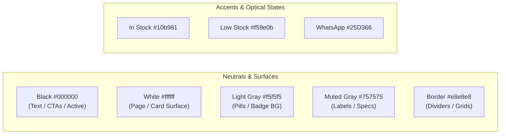

# Optii Optical Design System

> **Reference Brand:** Ace & Tate (`https://www.aceandtate.com/us/sunglasses/men-sunglasses`)  
> **Brand Persona:** Modern European / Scandinavian Editorial Optical Retailer  
> **Target Currency:** Indian Rupee (`₹` / INR)  
> **Core Aesthetic:** Flat, minimalist, typography-led, whitespace-driven, architectural, restrained motion.

---

## 1. Design Philosophy & Visual Principles

1. **Editorial Restraint over Commercial Clutter**
   - No unnecessary gradients, no heavy drop-shadows, no oversized bubbly cards, and no generic SaaS UI styling.
   - Visual priority belongs to high-fidelity photography (sharp 1:1 studio and editorial model shots) and typographic balance.

2. **Architectural Grid & Intentional Whitespace**
   - Layouts are structured on a rigid column grid with crisp 1px borders (`#e8e8e8`) separating functional zones.
   - High horizontal margins (40px desktop, 16px mobile) establish an expansive, premium physical-boutique feel.

3. **Subtle Tactility & Restrained Transitions**
   - Micro-interactions use snappy, elegant cubic-bezier curves (`cubic-bezier(0.16, 1, 0.3, 1)` ~150ms-250ms).
   - Product cards feature instantaneous studio-to-model image swaps on hover.
   - Variant color swatches provide immediate image reassignment with a 2px high-contrast active indicator ring.

4. **Clarity of Optical Measurements**
   - Frame measurements are treated as engineering specifications, not hidden footnotes.
   - Dimensions are explicitly displayed in millimeters (Lens width, Bridge width, Temple length) with clear size categorization (Narrow, Medium, Wide).

---

## 2. Ace & Tate Reference Extraction

Our visual and technical inspection of `aceandtate.com` captured the following exact design attributes:

| Element | Reference Value / Behavior | Optii Adaptation |
| :--- | :--- | :--- |
| **Header Height** | 56px to 64px, fixed/sticky with white background | 60px fixed header with sticky scroll behavior |
| **Announcement Bar** | 36px, black `#000000` with white `#ffffff` text | 36px high-contrast banner with rotating optical promos |
| **PLP Grid Density** | 4 columns on desktop (1440px), 8px col gap, 32px row gap; **2 columns on mobile (390px)**, 8px gap | Responsive 4-col (1440px), 3-col (1024px), 2-col (768px), **2-col compact on mobile (390px)** |
| **Image Aspect Ratio** | 1:1 Square (275px × 275px desktop, 183.6px × 183.6px mobile), 0px border-radius | Strict 1:1 square ratio with `0px` border-radius across all viewports |
| **Card Hover UX** | Immediate swap from studio packshot to editorial on-model | Dual-image slot per variant: studio shot default, editorial hover |
| **Color Swatches** | 28px container with 20px circular color dot, 8px gap, 2px active ring offset | 28px touch container, 20px circular dot with acetate/metal hex fills + active concentric ring |
| **Wishlist Placement** | Desktop: Top-right (36px); **Mobile: Bottom-right (36px)** to prevent scroll misclicks | Viewport-aware wishlist positioning (top-right on desktop, bottom-right on touch mobile) |
| **Filter Trigger** | Sticky pill button with counter `All filters (n)` (148.8px × 43.6px) | Sticky pill trigger opening smooth slide-over drawer |
| **Filter Drawer** | Left-slide drawer (~530px) with sticky footer and live count (`Clear all` + `(n) Apply` pills) | Left-slide drawer with visual shape SVGs, fit diagrams, price filters, sticky footer CTA |
| **PDP Gallery** | Full-width multi-image carousel + fullscreen zoom | Multi-image sticky gallery (studio, 45°, hinge detail, model) |
| **Pricing Model** | Sunglasses: "From $X"; Eyeglasses: "From $Y incl. lenses" | Transparent INR pricing: frame price + transparent lens upgrade tiers |
| **Mobile Actions** | Sticky bottom pill CTA (`Add to bag` / `Choose lenses`) | Sticky bottom action bar with frame name, price in INR, and CTA |

---

## 3. Colour Palette & Semantics



### 3.1 Base Tokens

```css
:root {
  /* Surface Tokens */
  --color-surface-primary: #ffffff;
  --color-surface-secondary: #fbfbfb;
  --color-surface-tertiary: #f5f5f5;
  --color-surface-inverted: #000000;

  /* Text Tokens */
  --color-text-primary: #000000;
  --color-text-secondary: #666666;
  --color-text-muted: #757575;
  --color-text-inverted: #ffffff;

  /* Border & Divider Tokens */
  --color-border-subtle: #e8e8e8;
  --color-border-medium: #d4d4d4;
  --color-border-dark: #000000;

  /* Brand & Communication Tokens */
  --color-brand-whatsapp: #25D366;
  --color-brand-whatsapp-hover: #1ebd5b;

  /* State Tokens */
  --color-state-success: #10b981;
  --color-state-warning: #f59e0b;
  --color-state-error: #ef4444;
  --color-state-info: #3b82f6;

  /* Optical Frame Palette (Default Acetates & Metals) */
  --acetate-black: #111111;
  --acetate-tortoise: #5a3825;
  --acetate-amber: #b2733b;
  --acetate-crystal: #e9eef2;
  --acetate-sage: #7d8b7b;
  --acetate-rose: #d8b2a7;
  --metal-gold: #d4af37;
  --metal-silver: #c0c0c0;
  --metal-rosegold: #b76e79;
  --metal-gunmetal: #41424c;
}
```

---

## 4. Typography System

The typography follows a geometric grotesque foundation inspired by **AmperSans** and **Helvetica Neue**, emphasizing tight letter-spacing for editorial headings and neutral clarity for technical lens specifications.

### 4.1 Type Hierarchy

| Level | Size (px) | Line Height (px) | Weight | Letter Spacing | CSS Utility / Use Case |
| :--- | :--- | :--- | :--- | :--- | :--- |
| **Display H1** | 54px | 68px | 500 | `-0.02em` | Homepage hero banners, major campaigns |
| **Heading H2** | 42px | 52px | 500 | `-0.015em` | Collection section headings, editorial features |
| **Heading H3** | 32px | 40px | 500 | `-0.01em` | Category titles, modal titles, drawer headers |
| **Heading H4** | 22px | 28px | 500 | `0em` | PDP product title, lens step titles |
| **Product H5** | 16px / 18px | 24px | 500 | `0em` | Product card titles, prices in INR |
| **Body Large** | 16px | 24px | 400 | `0em` | Editorial excerpts, brand descriptions |
| **Body Regular** | 14px | 20px | 400 | `0em` | Specifications, lens details, form inputs |
| **Caption / Specs**| 12px | 16px | 400 / 500 | `+0.02em` | Frame millimeter metrics, color names |
| **Overline / Badge**| 11px | 14px | 600 | `+0.06em` | Uppercase status badges (`NEW`, `BESTSELLER`) |

### 4.2 Font Stacks

```css
:root {
  --font-sans: -apple-system, BlinkMacSystemFont, "Segoe UI", Roboto, "Helvetica Neue", Arial, sans-serif;
  --font-mono: ui-monospace, SFMono-Regular, Menlo, Monaco, Consolas, monospace;
}
```

---

## 5. Spacing, Radii & Layout Dimensions

```
   +--------------------------------------------------------------+
   |  Announcement Bar (Height: 36px | Background: #000000)       |
   +--------------------------------------------------------------+
   |  Main Header (Height: 60px | Sticky | Border-Bottom #e8e8e8) |
   +--------------------------------------------------------------+
   |  Sticky Filter Bar (Height: 52px | Pill Trigger Button)      |
   +--------------------------------------------------------------+
   |                                                              |
   |   <---- 40px Margin ----> [ Product Grid (4-Col) ] <------>  |
   |                                                              |
   +--------------------------------------------------------------+
```

### 5.1 Dimensions & Metrics

| Dimension | Token | Value | Description |
| :--- | :--- | :--- | :--- |
| **Max Page Width** | `--container-max-width` | `1440px` | Center-constrained container for wide monitors |
| **Header Height** | `--height-header` | `60px` | Main desktop & mobile navigation bar |
| **Announcement Height**| `--height-announcement` | `36px` | Top promotional bar |
| **Filter Bar Height** | `--height-filter-bar` | `52px` | Sticky filter & sorting strip |
| **Horizontal Margin** | `--margin-layout` | `40px` (desktop), `16px` (mobile) | Side gutters |
| **Column Gap** | `--gap-grid-col` | `8px` | Tight modern editorial spacing |
| **Row Gap** | `--gap-grid-row` | `32px` | Clear vertical breathing room |
| **Card Radius** | `--radius-card` | `0px` | Crisp, sharp architectural card edges |
| **Pill Radius** | `--radius-pill` | `9999px` | Buttons, filter chips, search input, badges |
| **Input Radius** | `--radius-input` | `4px` | Form inputs, dropdowns, booking pickers |

---

## 6. Component Interaction Specifications

### 6.1 Product Card
- **Aspect Ratio:** Strict 1:1 square canvas (`275px × 275px` on 1440px desktop; `183.6px × 183.6px` on 390px mobile).
- **Corner Geometry:** Sharp `0px` border-radius (square corners) on all product photography, establishing the signature Dutch optical retail look.
- **Image Behavior:** Contains two layers:
  - *Layer 1 (Studio packshot):* Neutral clean cut-out on white surface.
  - *Layer 2 (Model / Lifestyle):* Fades in smoothly (`opacity 100%`, transition `150ms ease-in-out`) on desktop hover.
- **Wishlist Action:** 
  - *Desktop (≥1024px):* Positioned 12px from the **top-right** (36px circular touch area).
  - *Mobile (<768px):* Intelligently moved to the **bottom-right** of the image square (36px touch area) to avoid thumb collision while vertical scrolling.
  - Displays unliked stroke or black filled heart on click.
- **Color Swatches:**
  - Placed directly under the product title and price.
  - 28px diameter touch targets with 20px inner circular color dot and 8px horizontal gap.
  - Active swatch features an outer black concentric ring (`2px solid #000000` with `2px` white gap).
  - Hovering or clicking a swatch dynamically swaps the product images and updates the color label (e.g. `Tigerwood Acetate`).
- **Price Display:** Clean Indian Rupee representation (e.g., `₹9,500` or `₹12,000`).

### 6.2 Filter Drawer
- **Trigger:** Sticky pill button `All filters (n)` with icon.
- **Drawer Behavior:** Smooth slide-out from left (450px wide on desktop, 100% viewport width on mobile) with backdrop blur (`backdrop-filter: blur(4px)`).
- **Filter Facets:**
  1. *Frame Shape:* Visual SVG line-art tiles (Round, Square, Aviator, Cat-Eye, Oval, Rectangle).
  2. *Frame Fit / Width:* Visual head-width diagrams (Narrow: <130mm, Medium: 130-138mm, Wide: >138mm).
  3. *Gender:* Unisex, Men, Women.
  4. *Material:* Bio-Acetate, Italian Acetate, Titanium, Stainless Steel.
  5. *Color:* Palette circles with tooltip labels.
  6. *Price Range:* Slider and discrete range pills (Under ₹8,000, ₹8,000 - ₹12,000, Above ₹12,000).
- **Sticky Drawer Footer:** Clear All link + dynamic black pill CTA displaying matching product count: `Show (48) results`.

### 6.3 Frame Specifications Block (PDP)
Optical consumers require exact fit measurements. The specs block displays an optical schematic with 3 key metrics:
```
           [ Lens Width ]       [ Bridge ]       [ Temple Length ]
               51 mm              20 mm               150 mm
```
- Accompanied by frame size classification (e.g., `Medium Fit`) and weight in grams.

### 6.4 Progressive 4-Step Lens Selector
A guided four-step modal/drawer flow:
1. **Step 1: Lens Usage** (Single Vision - Distance, Single Vision - Reading, Progressive / Multifocal, Non-Prescription / Fashion).
2. **Step 2: Prescription Entry** (Upload doctor prescription file OR manual input of SPH, CYL, AXIS, ADD, PD).
3. **Step 3: Lens Thickness / Index** (Standard 1.50, Thin 1.60, Super Thin 1.67, Ultra Thin 1.74 with thickness visual comparison and index recommendation based on SPH).
4. **Step 4: Lens Coatings** (Clear Anti-Reflective, Blue Light Filter, Polarised Sunglasses, Photochromic Transitions).
- **Live Summary Bar:** Displays selected frame + incremental lens costs = Total Price in INR.

### 6.5 WhatsApp Enquiry & Eye Test Booking
- **WhatsApp CTA:** Direct enquiry button generating pre-formatted URL:
  `https://wa.me/{CONFIG_PHONE}?text={ENCODED_PRODUCT_PAYLOAD}`
  Prefilled with: Product Name, SKU, Selected Color, Frame Measurements, and Selected Lenses.
- **Eye Test Booking:** In-store appointment booking with store location selector, calendar date picker, live available slot pills (e.g., `10:30 AM`, `11:15 AM`), customer name/phone/email, and confirmation.
