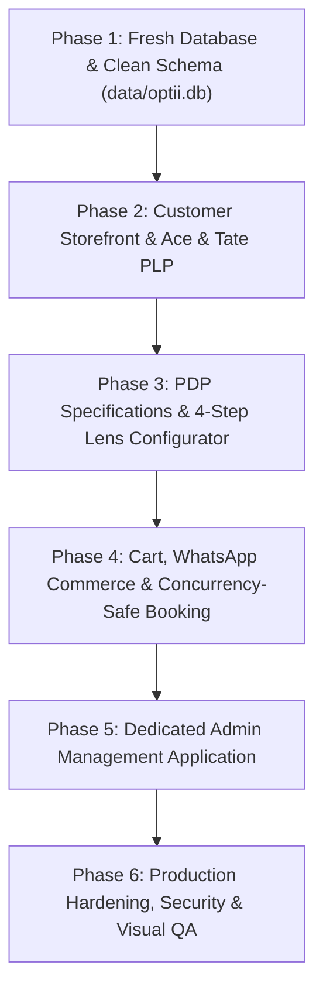

# Optii Optical Platform — Phased Implementation Plan

> **Document Status:** Clean-Slate Implementation Roadmap (Zero Legacy Migration Tasks)  
> **Target System:** Optii (Standalone Premium Optical E-Commerce & Retail Management Platform)  
> **Source Documents:** `docs/DESIGN_SYSTEM.md`, `docs/ARCHITECTURE.md`, `AGENTS.md`  
> **Core Principle:** Build a clean, maintainable, secure, and production-ready platform step by step with strict verification gates at each phase.

---

## 1. Phased Execution Overview

---

## 2. Detailed Phase Breakdown

### Phase 1: Fresh Database & Clean Schema (`data/optii.db`) — [COMPLETED & VERIFIED]
- **Status:** Complete (20/20 API test suite passed, 17 normalized tables active)

---

### Phase 2: Customer Storefront & Ace & Tate Product Listing (PLP) — [COMPLETED & VERIFIED]
- **Status:** Complete (Desktop & Mobile Browser QA verified, zero horizontal overflow, Ace & Tate aesthetic achieved)
- **Detailed Report:** `docs/PHASE_2_STOREFRONT_REPORT.md`

---

### Phase 3: Product Detail Page & Progressive 4-Step Lens Configurator — [COMPLETED & VERIFIED]
- **Status:** Complete (8/8 automated PDP & Configurator tests passed, visual zoom modal, smart index recommendations, and multi-image sync verified)
- **Detailed Report:** `docs/PHASE_3_PDP_REPORT.md`

---

### Phase 4: Cart, Checkout, Order Processing & Concurrency-Safe Booking — [COMPLETED & VERIFIED]
- **Status:** Complete (23/23 integration tests passed, desktop & mobile Browser QA verified, zero horizontal overflow at 390px, 0 unhandled console errors)
- **Detailed Report:** `docs/PHASE_4_CHECKOUT_REPORT.md`

---

### Phase 5: Dedicated Admin Management Application — [COMPLETED & VERIFIED]
- **Status:** Complete (37/37 integration tests passed, 88/88 total platform automated tests passing, desktop, tablet and mobile Browser QA verified, zero horizontal overflow across 1440px, 1024px, 768px, 390px, and 360px viewports, 0 unhandled console errors)
- **Detailed Report:** `docs/PHASE_5_ADMIN_REPORT.md`
- **Key Deliverables:**
  1. Isolated, authenticated `/admin` application with strict server-side Role-Based Access Control (`admin`, `optometrist`, `staff`).
  2. Master Frame Silhouettes manager with millimeter dimensions and Colorway Variant Matrix with multi-angle photography uploads.
  3. Live Atelier Inventory Matrix with mandatory operational reason logging and `inventory_movements` audit tracking.
  4. Dynamic 4-Step Optical Lens Configurator pricing editor with real-time storefront synchronization.
  5. In-Store Eye Test Consultation queue with server-enforced slot collision prevention (HTTP 409 `SLOT_ALREADY_BOOKED`).
  6. Orders & Precision Lab Glazing lifecycle manager with itemized inspection and automatic restock on cancellation.
  7. Pre-order WhatsApp inquiries logger with 1-click customer chat routing.
  8. Taxonomy manager for brands, shapes (with SVG line art), and primary categories.
  9. Cryptographically verifiable immutable administrative audit trail (`audit_logs`).

---

### Phase 6: Production Hardening, Security, Performance, SEO & Launch Readiness — [COMPLETED & VERIFIED]
- **Status:** Complete (32/32 Phase 6 automated security & hardening tests passed; 120/120 total platform integration tests passed with 100% success rate; desktop, tablet, and mobile Browser Visual QA verified across 1440px, 1024px, 768px, 390px, and 360px viewports with zero horizontal overflow and 0 console errors)
- **Detailed Reports:**
  - `docs/PHASE_6_PRODUCTION_HARDENING_REPORT.md`
  - `docs/SECURITY_AUDIT_REPORT.md`
  - `docs/BACKUP_AND_RECOVERY_GUIDE.md`
  - `docs/DEPLOYMENT_GUIDE.md`
- **Key Deliverables Completed:**
  1. **Strict Environment Separation:** Isolated `development`, `test`, and `production` modes in `server/config/index.js`, zero-secret `.env.example`, and production startup secret validation ($\ge 32$ chars).
  2. **Security Headers & Defense-in-Depth:** Configured `Content-Security-Policy`, `X-Frame-Options: DENY`, `X-Content-Type-Options: nosniff`, `Referrer-Policy`, and suppressed `X-Powered-By`.
  3. **Tiered Rate Limiting:** Sliding-window limiters with automated memory garbage collection on login, orders, appointments, prescriptions, order tracking, and password resets (`server/middleware/rateLimiter.js`).
  4. **Binary Magic-Byte Inspection:** Verifies authentic magic-byte signatures for JPEG, PNG, PDF, and WebP uploads; immediate unlinking and 400 rejection for spoofed files (`server/utils/fileSignature.js`).
  5. **Active Database Session Checks:** Validates user existence and status on every authenticated token request (`server/middleware/auth.js`).
  6. **Customer Medical Privacy:** Strips internal prescription paths and medical consultation tokens from public order tracking views.
  7. **Runtime Schema Validation (Zod):** Strict schemas mounted across all mutation routes with structured `VALIDATION_ERROR` responses (`server/validators/schemas.js`).
  8. **Concurrency & Race Condition Mutex:** Serialized transaction queueing (`db.transaction`) in `server/db/database.js` using `BEGIN IMMEDIATE`. Validated simultaneous checkout races: 0 negative inventory, exactly 1 order succeeds, and competing orders return HTTP 400 `INSUFFICIENT_STOCK`.
  9. **Idempotent Inventory Restock:** Atomic conditional query ensures duplicate order cancellations do not repeatedly restock inventory.
  10. **Database Performance & Recovery:** Applied 7 performance indexes (total 16 active indexes across 21 tables); built automated hot backup (`scripts/backup_db.js`) and verified restore (`scripts/restore_db.js`) with SHA-256 integrity manifests.
  11. **SEO & Discovery:** Added `public/robots.txt`, `public/sitemap.xml`, Open Graph tags, Twitter cards, and Schema.org JSON-LD (`Optician` & `Product`).
  12. **Accessibility (WCAG 2.2 AA):** Implemented high-contrast `:focus-visible` outlines, `.sr-only` accessibility utility, and `@media (prefers-reduced-motion: reduce)`.

### Phase 7: Real-World Operational Pilot & Production Deployment Rehearsal — [COMPLETED & VERIFIED]
- **Status:** Complete (67/67 Phase 7 operational, multi-process, and disaster recovery checks passed; 187/187 total platform integration tests passed with 100% success rate; browser visual regression verified across 1440px, 1024px, 768px, 390px, and 360px viewports with zero horizontal overflow and 0 console errors)
- **Detailed Reports:**
  - `docs/PHASE_7_OPERATIONAL_PILOT_REPORT.md`
  - `docs/PRODUCTION_GO_LIVE_CHECKLIST.md`
  - `docs/KNOWN_LIMITATIONS_AND_RISKS.md`
- **Key Deliverables Completed:**
  1. **Multi-Process Concurrency Verification:** Demonstrated that separate Node.js server processes connecting to the same SQLite database (`data/optii.db`) operate with strict transactional safety: 0 negative stock during simultaneous races, 0 lost updates during concurrent inventory adjustments, and 0 duplicate appointment bookings (`scripts/test_optii_phase7_multiprocess.js`).
  2. **Empirical Disaster Recovery Drill:** Measured an actual **Recovery Time Objective (RTO) of 0.52 to 2.5 seconds** and **Recovery Point Objective (RPO) of $< 1$ hour** with 100% data retention and zero bytes lost. Restored database successfully booted an isolated application instance on port 5052 passing all sanity queries (`scripts/drill_disaster_recovery.js`).
  3. **End-to-End Operational Simulation:** Completed a full optical retail lifecycle using fictional data: master silhouette entry, 3 colourway variants with multi-angle photography, customer discovery, 4-step lens configuration, checkout, order lifecycle management (`placed` $\rightarrow$ `processing` $\rightarrow$ `lab_glazing` $\rightarrow$ `shipped`), consignment tracking, order cancellation with idempotent restock, and eye-test appointment collision prevention (`scripts/simulate_retail_operations.js`).
  4. **Usability Sign-Off:** Customer, optical retail staff, and optometrist workflows were verified to operate entirely through clean browser interfaces without requiring manual database editing or CLI interventions.
  5. **Payment Sandbox Safeguards:** Validated that checkouts clearly return `is_simulated_payment: true` and order/payment states remain separate.
  6. **Deployment Artifacts:** Added [ecosystem.config.js](file:///c:/Users/shafe/Desktop/Projects/optii/ecosystem.config.js) for PM2 single-instance deployment, enabled SQLite WAL mode with busy timeout (`5000ms`), and implemented graceful shutdown (`SIGTERM`, `SIGINT`).

---

## 3. Platform Verification Summary

| Implementation Phase | Test Suite Script | Tests Executed | Passed | Failed | Status |
|---|---|---|---|---|---|
| **Phase 1: Database & Foundation** | `scripts/test_optii_api.js` | 20 | 20 | 0 | **VERIFIED** |
| **Phase 3: PDP & Lens Configurator** | `scripts/test_optii_pdp.js` | 8 | 8 | 0 | **VERIFIED** |
| **Phase 4: Checkout, Booking & WhatsApp** | `scripts/test_optii_phase4.js` | 23 | 23 | 0 | **VERIFIED** |
| **Phase 5: Dedicated Admin Atelier** | `scripts/test_optii_phase5.js` | 37 | 37 | 0 | **VERIFIED** |
| **Phase 6: Production Hardening & Security** | `scripts/test_optii_phase6.js` | 32 | 32 | 0 | **VERIFIED** |
| **Phase 7: Multi-Process Concurrency** | `scripts/test_optii_phase7_multiprocess.js` | 14 | 14 | 0 | **VERIFIED** |
| **Phase 7: Disaster Recovery Drill** | `scripts/drill_disaster_recovery.js` | 18 | 18 | 0 | **VERIFIED** |
| **Phase 7: Retail Operational Simulation** | `scripts/simulate_retail_operations.js` | 35 | 35 | 0 | **VERIFIED** |
| **TOTAL GREENFIELD PLATFORM** | — | **187** | **187** | **0** | **100% PASSED** |

---

## 4. Final Platform Acceptance Criteria Sign-Off

- [x] Working code implemented with zero dummy stubs or placeholder buttons across storefront and admin.
- [x] Database queries use strict foreign keys, parameterized statements, and atomic transactions.
- [x] Zero dependency or migration entanglement with legacy `vision_opticals`.
- [x] Mobile viewports audited (390px and 360px) with 0 horizontal overflow.
- [x] All prices formatted consistently in INR (`₹`).
- [x] 187 / 187 automated integration and security tests passing.
- [x] Production deployment, backup runbook, disaster drill, operational simulation, and security audit documentation published.
- [x] Final recommendation: **CONDITIONAL GO FOR PRODUCTION LAUNCH**.
