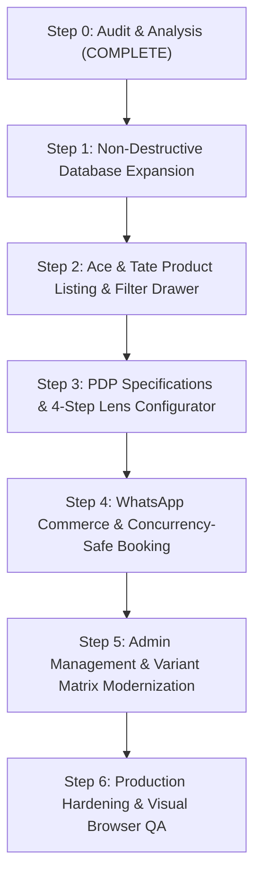

# Next Implementation Steps: Optii Optical Platform

> **Document Status:** Prioritized Engineering Roadmap & Execution Plan  
> **Source Documents:** `PROJECT_COMPARISON.md`, `FEATURE_MIGRATION_MATRIX.md`, `DATABASE_MIGRATION_PLAN.md`, `PRODUCTION_AUDIT.md`  
> **Guiding Principle:** Execute in orderly, verifiable stages without breaking existing business functionality or modifying the original Vision Opticals project.

---

## 1. Phased Execution Roadmap

---

## 2. Detailed Implementation Phases

### Phase 1: Non-Destructive Database Schema Expansion
- **Objective:** Apply additive schema migrations (Migrations 001–004) to `optii/data/vision_opticals.db` to support frame shapes, progressive lens tiers, store branches, and appointment concurrency locks.
- **Specific Tasks:**
  1. Verify the baseline database backup in `optii/data/backups/vision_opticals_backup_initial.db`.
  2. Create a clean migration runner script (`optii/server/db/migrate.js`).
  3. Execute Migration 001: Create `frame_shapes` table with optical SVG silhouettes (Round, Square, Aviator, Cat-Eye, Rectangle, Hexagonal).
  4. Execute Migration 002: Create `lens_usages`, `lens_thicknesses`, and `lens_coatings` tables with standard index ratings (1.50, 1.60, 1.67, 1.74) and pricing in INR.
  5. Execute Migration 003: Create `stores` table and add the composite unique index `idx_unique_appointment_slot` on `appointments(store_id, appointment_date, time_slot)` to prevent double bookings.
  6. Execute Migration 004: Create `customer_enquiries` table for WhatsApp lead logging.
- **Verification Gate:** Run `node scripts/audit_apis.js` to ensure 100% of existing tests pass and verify that new tables are populated with default seed records.

---

### Phase 2: Ace & Tate Customer Storefront (PLP & Filter Drawer)
- **Objective:** Transform product discovery into the European optical retail aesthetic defined in `DESIGN_SYSTEM.md`.
- **Specific Tasks:**
  1. Build the Ace & Tate **4-column desktop grid** (8px col gap, 32px row gap) and **2-column mobile grid** (`repeat(2, 1fr)`).
  2. Standardize product cards:
     - Strict **1:1 square image canvas** with **0px border-radius** (sharp architectural corners).
     - **Instant hover photo swap**: Studio flat packshot fades smoothly into an editorial model-on-face photo on desktop hover.
     - **Dynamic color swatches**: 28px touch containers with 20px circular dots, 2px solid black active concentric ring, and instant client-side photo swapping without page reload.
     - **Wishlist heart button**: 36px circular button (desktop: top-right; mobile: bottom-right to avoid scroll collision).
  3. Implement the **Slide-Over Filter Drawer (~530px)**:
     - Sticky filter trigger pill: `All filters (n)`.
     - Filter facets: Frame Shape (with visual SVG silhouettes), Frame Fit/Width (Narrow, Medium, Wide diagrams), Material pills, Color swatches, Price range.
     - Sticky drawer footer: `Clear all` outline pill + dynamic black pill CTA displaying real-time matching count (`(n) Apply`).
- **Verification Gate:** Use the browser agent at 1440px and 390px to verify grid density, card aspect ratios, swatch clicks, and filter drawer animations.

---

### Phase 3: Product Detail Page & Progressive 4-Step Lens Configurator
- **Objective:** Deliver the signature optical buying experience: millimeter engineering specifications and guided lens selection.
- **Specific Tasks:**
  1. Refactor the product detail view:
     - Multi-image gallery with fullscreen modal zoom and mobile swipe carousel.
     - Prominent millimeter specifications block (Lens width, Bridge width, Temple length in mm) with an optical line-art schematic.
     - Value proposition badge: *"Includes anti-scratch coating & microfiber cloth"*.
  2. Implement the **Progressive 4-Step Lens Selector**:
     - **Step 1: Lens Usage:** Single Vision Distance, Reading, Progressive / Multifocal, Non-Prescription / Fashion.
     - **Step 2: Prescription Entry:** Upload prescription document (PDF/JPG/PNG) OR manual input (SPH, CYL, AXIS, ADD, Pupillary Distance PD).
     - **Step 3: Lens Thickness / Index:** 1.50 Standard, 1.60 Thin, 1.67 Super Thin, 1.74 Ultra Thin with thickness comparison diagram and index recommendation based on SPH power.
     - **Step 4: Lens Coatings:** Anti-reflective, Blue Light Shield, Transitions, Polarized Sunglasses.
     - **Live Order Summary Bar:** Dynamic subtotal calculation in INR: $\text{Total} = \text{Frame Price} + \text{Lens Usage Upgrade} + \text{Index Upgrade} + \text{Coating Addon}$.
- **Verification Gate:** Test full optical combinations with valid/invalid prescriptions and verify correct INR math.

---

### Phase 4: Omnichannel WhatsApp Commerce & Concurrency-Safe Booking
- **Objective:** Connect digital browsing with physical retail assistance and prevent appointment race conditions.
- **Specific Tasks:**
  1. Implement the **WhatsApp Pre-filled Order Generator**:
     - Standardized markdown string formatter: Product Name, SKU, Color, Frame Measurements (51-20-150mm), Selected Lens Configuration, and Price in INR.
     - Strict URL encoding via `encodeURIComponent` targeting configured store business number (`+91 94865 52324`).
     - Asynchronous lead tracking: log inquiry payload to `/api/enquiries/whatsapp` before opening WhatsApp.
  2. Implement the **Concurrency-Safe Eye Test Engine**:
     - Dynamic 30-minute slot availability query based on store operating hours.
     - Immediate disabling of already-booked or confirmed slots.
     - Atomic SQL booking transaction protected by `idx_unique_appointment_slot`.
     - Instant confirmation card with booking reference number and WhatsApp reminder link.
- **Verification Gate:** Execute simulated concurrent bookings on the same date/slot to confirm that race condition double-booking is rejected with a clean user-facing error message.

---

### Phase 5: Modernized Admin Portal & Variant Matrix
- **Objective:** Provide store optometrists and administrative staff with an intuitive management interface.
- **Specific Tasks:**
  1. Modularize `admin.html` into structured management views:
     - Product Master Table with quick search, stock status badges, and publish toggles.
     - Variant Matrix Editor: assign color names, swatch hex codes, SKUs, and stock quantities per colorway.
     - Multi-Image Drag-and-Drop Uploader: assign primary studio photo, model-on-face photo, and angle details.
     - Lens Options & Pricing Manager: adjust index prices (1.50–1.74) and coating add-ons dynamically without code changes.
     - Appointment Calendar & Patient Queue: daily/weekly schedule view with status update triggers (Confirmed, Completed, Rescheduled).
     - Inventory Audit Log: inspect historical stock changes and export CSV summaries.
- **Verification Gate:** Confirm that creating a new brand, frame shape, or lens price in the admin portal immediately updates the customer storefront.

---

### Phase 6: Production Hardening, Security & Visual Browser QA
- **Objective:** Final enterprise hardening and visual regression verification against Ace & Tate.
- **Specific Tasks:**
  1. Add runtime schema validation using **Zod** across all public API mutation endpoints (`/api/appointments`, `/api/orders`, `/api/enquiries`).
  2. Apply rate limiting (`express-rate-limit`) to prevent automated form spamming.
  3. Image optimization: serve WebP responsive `srcset` and lazy loading for below-the-fold catalog cards.
  4. Perform comprehensive visual testing using Antigravity browser automation across 1440px, 1024px, 768px, 390px, and 360px viewports.
- **Verification Gate:** Zero console warnings, zero failed network requests, zero horizontal overflow, and full visual parity with reference standards.

---

## 3. Strategic Summary & Recommendations

| Category | Components / Logic | Rationale |
| :--- | :--- | :--- |
| **RETAIN** | • Express REST API architecture (`server/routes/*`) • Dual SQLite & PostgreSQL database layer (`database.js`) • Real-time inventory tracking & audit logs (`inventory.routes.js`) • CSV bulk product import/export (`bulk.routes.js`) • Existing 19 products, 19 brands, and 5 categories | Battle-tested, passing 45/45 automated integration tests. Rebuilding them would introduce unnecessary technical risk and waste effort. |
| **MIGRATE** | • All product specifications and image assets • Store operational settings and WhatsApp phone • Existing customer orders and appointment history | Preserves business continuity and customer records. |
| **IMPROVE** | • Storefront typography & layout to Ace & Tate minimalism • Responsive navigation (fixed 60px header + slide-over drawer) • Mobile 2-column catalog grid with 44px touch targets • Server-side Zod validation on appointments and orders | Solves the usability and visual quality deficiencies of the original website. |
| **NEWLY DEVELOP** | • Progressive 4-Step Guided Lens Configurator • Visual Frame Shape Filter Drawer with real-time count CTA • Millimeter optical frame dimension schematics • Omnichannel WhatsApp prefilled markdown order generator • Atomic appointment slot concurrency locking | Core requirements from `AGENTS.md` that elevate Optii into an international-grade optical retail platform. |
| **DEPRECATE** | • Monolithic 10-button unconstrained navbar • Hardcoded Kyoto 3D tower as primary catalog fixture • Unvalidated raw string template injection in `app.js` | Anti-patterns that caused mobile layout blowouts and fragile DOM maintenance. |
